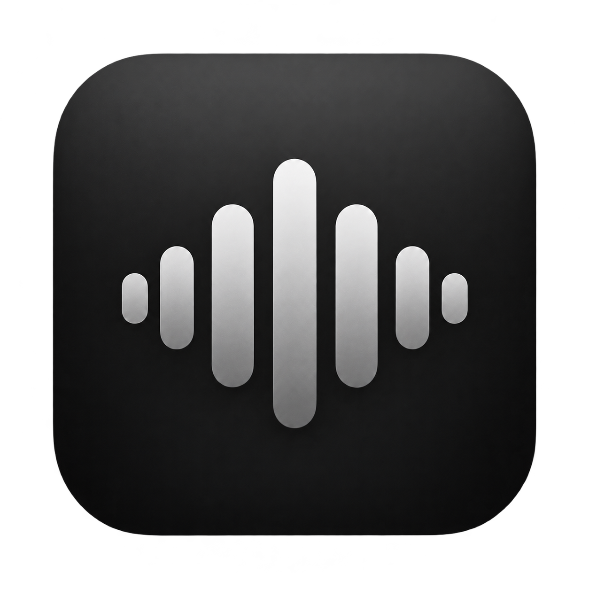

# Reson



A lightweight native macOS player for local lossless music. Rust handles playback; SwiftUI and AppKit provide the interface. No accounts, telemetry or cloud services.

## Download

**[Download the latest release](https://github.com/olivecarney/reson/releases/latest)** for Apple Silicon. Open the `macos-arm64.dmg`, drag **Reson** to **Applications**, then eject the disk image and open Reson from Applications.

The app targets macOS 14 or newer. Compatibility across older macOS versions is still being tested; Intel Macs are not supported.

The DMG includes a drag-to-Applications layout and a SHA-256 checksum. Releases are ad-hoc signed and are not Apple-notarized. If macOS blocks a trusted download, attempt to open it, then choose **System Settings → Privacy & Security → Open Anyway**.

## Listen

- Press **⌘O** to open and play a FLAC or PCM WAV file.
- Press **⇧⌘O** to import a music folder into your library.
- Double-click a track or press **Return** to play it. Use **Space** to pause or resume.
- Create playlists with **⌘N**, or use **Play Next** and **Add to Queue** from a track's context menu.

Reson supports searching and sorting your library, embedded artwork, seeking, app volume and mute, output-device selection, persistent playlists, and M3U8 import/export. Your music stays in its original folders.

See the [user guide](docs/user-guide.md) for controls, library storage and troubleshooting. Playback is not guaranteed to be bit-perfect or gapless; see [audio behaviour](docs/audio.md).

## Build from source

You need an Apple Silicon Mac, Xcode 26 or newer with the macOS 26 SDK and Swift 6.2+, current stable Rust with the `aarch64-apple-darwin` target, and Python 3.10+. CI uses Rust 1.99.0.

```sh
git clone https://github.com/olivecarney/reson.git
cd reson
./scripts/build.sh
./scripts/run.sh
```

The app is built at `build/Reson.app`. Rebuild after source changes; `run.sh` launches the existing app and builds only if it is missing. The first build downloads Rust dependencies. After caching them, use `CARGO_NET_OFFLINE=true ./scripts/build.sh` to build offline.

To create a verified DMG from the existing build, run `./scripts/package.sh`. Packaging installs pinned, hash-checked build tools into an isolated environment under `build/`; these are not part of the app.

## Contribute

Start with [CONTRIBUTING.md](CONTRIBUTING.md). Bug reports, accessibility improvements, testing on older macOS versions and focused features are welcome.

- [Architecture](docs/architecture.md): components, threading and data ownership.
- [Testing](docs/testing.md): automated checks and optional playback tests.
- [Performance](docs/performance.md): repeatable measurements and benchmarks.
- [Releases](docs/releases.md): packaging, versioning and publication.

Please follow the [code of conduct](CODE_OF_CONDUCT.md). Report vulnerabilities through the [security policy](SECURITY.md).

## License

Original Reson code and app artwork are available under the [MIT license](LICENSE). Dependencies retain their own licenses; release bundles include their notices. Audio fixtures are original synthetic test data, with [provenance](tests/fixtures/README.md).
